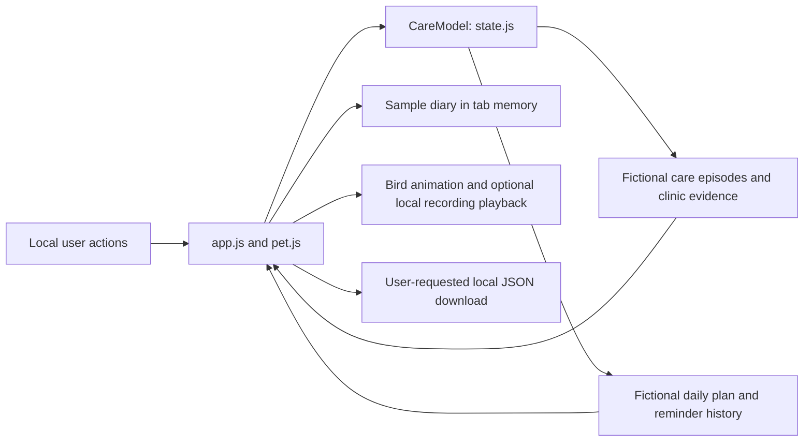

# Raise Your Nightingale — local prototype architecture

The application connects a playful daily care diary with a separate screening-to-care episode. It runs entirely in a browser tab, using fixed fictional cases and an authored demo plan. No external integration, AI model, real patient record or medical decision is involved.

## Components

| File | Responsibility |
| --- | --- |
| `index.html` | Loads local styles and the state, audio, companion-behavior, presentation and action scripts. |
| `state.js` | Pure state transitions, fictional dates, case evidence, scheduled-task simulation and event history. Exposes `window.CareModel` in the browser and `module.exports` in Node. |
| `pet.js` | Produces the companion, daily-plan and diary presentation from state. Bird growth is derived from self-report event counts. |
| `behavior.js` | Pure helpers for ordered activity reactions, daily-completion celebrations, performance milestones and reminder-attempt behavior. |
| `app.js` | Renders the English interface, handles actions, keeps sample diary entries and audio preferences in memory, and exports a fictional JSON log on request. Plays the bundled local recording through `audio.js`. |
| `audio.js` | Plays bounded excerpts from one local WAV, controls cancellation/live volume, and synchronizes three mouth shapes to a precomputed waveform envelope. Exposes `window.NightjarAudio` in the browser and CommonJS exports for tests. |
| `styles.css`, `pet.css` | Layout, responsive presentation, bird growth and feeding/dancing/singing/expression animations. |
| `assets/` | Existing Nightingale bird with its MIT notice, original sample meal/glucose SVG illustrations and the selected 9.7-second nightjar WAV. The sample images are not photographs; the recording has a separate CC BY 4.0 license and attribution. |
| `server.cjs` | Node built-in HTTP static server, bound only to `127.0.0.1:4173`. Serves an explicit file allowlist using GET/HEAD; there are no API or upload endpoints. |
| `tests/state.test.cjs` | Node built-in tests for transitions, closure gates, reminders, recurrence, self-report separation, reset independence and browser exports. |
| `tests/audio.test.cjs` | Node built-in tests for playback bounds, volume, stop/cancellation, superseding calls, mouth states and errors. |
| Companion-behavior tests | Verify reaction ordering and reminder escalation independently of DOM animation. |



## Two independent records

The care model holds `{ day, cases, tasks }`. Each transition clones its input; invalid operations throw before any changed state is returned. There is no database, browser storage, service worker, background job or persistence. Reload restores the fixtures. The two-step Reset control also clears the bird’s activity history, diary, tasks and cases. Audio preferences are presentation settings, not medical records.

**Care episode:** A01 starts with a result ready, B02 with a notification awaiting acknowledgement, and C03 with an appointment whose date has passed. Each record includes a stage, stage date, appointment date, escalation/help flags, actor-attributed events and evidence flags. Stages are result ready → notified → acknowledged → accepted referral → booked → care evidence → episode closed.

Attendance evidence cannot be recorded before the fictional appointment date. Closing an episode requires a visit/test record, clinician review and a next follow-up plan; an unresolved help request blocks closure. Neither a reminder nor a booking supplies evidence of care. Help requests are routed only within this demonstration. Closed episodes cannot accept new help requests; separate future support episodes are outside this version’s scope.

**Daily plan:** A01 has five authored tasks. Dates and frequencies are fixed demonstration values agreed by the fictional person and clinician. They are not derived from test values, population statistics or an algorithm.

| Task | Initial due day | Displayed plan time | Recurrence in the demo |
| --- | --- | --- | --- |
| Medication check-in | 1 | 08:00 | One day after the previous self-report |
| Meal record | 1 | 12:00 | One day after the previous self-report |
| Glucose record | 1 | 18:00 | One day after the previous self-report |
| Routine lab check | 2 | 09:00 | One-off |
| Routine diabetes visit | 3 | 10:00 | One-off; separate from the eye-screening referral |

`advanceDay()` moves the whole-day simulator and invokes `runDueTasks()`. A due or overdue unfinished task receives at most one `reminder_simulated` event per demo day. Running the scheduler again on the same day does not duplicate the event. Displayed times do not trigger a real clock or background notification.

Reminder presentation uses the attempt count for the current unfinished occurrence of each task, rather than the lifetime count across completed occurrences. Attempts one, two and three become progressively louder within the user-set volume limit. The fourth and later attempts add the signature side-eye and use the same recording unless muted. Advancing whole demo days drives these attempts; this is not a background retry service.

An unfinished recurring task stays overdue until a self-report is recorded. `completeTask()` rejects early, duplicate one-off and unknown-task completions. One-off tasks become complete; recurring tasks advance to completion day plus their fictional interval. This recurrence rule is a demo simplification, not a recommendation for rescheduling medication, measurements or care.

Daily `completed_self_report` events never modify a case’s clinical-evidence flags or close its episode. They can continue after one episode closes because ongoing care and a single referral are different records. The care-team view shows missed daily check-ins separately, without representing them as verified adherence or a health assessment.

## Companion and sample diary

The bird has four visual growth levels, derived as `min(3, floor(selfReportCount / 2))`. Recording medication triggers feeding with one worm. A meal record triggers a smile without judging the meal's contents. When all three daily activities have been recorded for today, the bird adds a happy wing flap. Each sixth saved activity earns singing; other multiples of three earn a dance. These milestone performances queue after the activity reaction and any daily-completion celebration. Performances finish with a playful side-eye; there is no free-play action menu. All daily-plan self-reports count toward cumulative milestones, including routine test/visit self-reports. Growth reflects recorded activity only; it does not estimate health, nutrition, treatment adherence or disease control. Missing a record does not shrink or punish the bird.

Meal and glucose actions open a sample-capture dialog. Saving adds an in-memory diary entry and a task self-report. The glucose illustration always uses the pre-filled fictional value **128 mg/dL**. The application does not access a camera, accept real photos, upload a file, perform OCR, infer nutrition or interpret glucose.

Optional bird calls use the locally bundled, user-selected 9.7-second nightjar WAV through one HTMLAudio element, at its original pitch and rate with looping disabled. `audio.js` controls excerpt duration, playback cancellation and bounded live volume. Three mouth shapes follow a precomputed 20 ms waveform envelope using the media playback position. No oscillator synthesis or external audio request remains. Sound is enabled through a user interaction in **Bird calls**. Its toggle immediately stops playback; volume can be adjusted live down to zero. Open disclosure panels and the current playback status survive a render.

The current UI invokes due/overdue audio when advancing the whole-day clock or when a manual scheduler run creates new reminder events, a due cue when enabling sound, and a full-clip song at an earned concert. Although the audio helper defines medication, meal and glucose excerpt plans, the current UI does not individually call them at their displayed plan times. Calls occur only during local interactions, with no background alarms, automatic repeat loop or delivery guarantee. The recorded species is a nightjar; the visual companion remains the pixel nightingale.

## Local operation, cost and boundaries

Run with an installed Node version supported by `package.json`:

```sh
npm start
npm run check
npm test
```

No package installation is needed: runtime and tests use built-in browser/Node APIs. Running the application requires no model calls, API keys, cloud resources or paid services. This describes application execution costs; it does not claim that real clinical deployment would be free.

The static server sends a content security policy that restricts resources to local files and blocks network connections with `connect-src 'none'`. Its allowlist excludes source documentation, test files and repository metadata from HTTP serving. External source links open only if deliberately followed; they are references, not data feeds. Export creates a local JSON download containing the fictional cases, task history and sample diary.

The role switch is presentation only. It is not authentication, permission enforcement, clinician verification or a production audit system. No notification provider, calendar, laboratory, electronic health record, Malaffi, Sehatna or care-provider capacity service is connected. Simulated event labels are not delivery receipts or independent evidence.

## Evidence and remaining work

Automated checks cover the deterministic workflow and task engine; they do not establish clinical benefit, usability, language comprehension, culture fit or real-world completion rates. All UI counters describe the fixed fictional cases. No clinical improvement or UAE suitability has been demonstrated.

Before any real use, the project would need a consented validation process, clinically reviewed plan-setting rules, suitable identity/access controls, durable records, actual delivery and care integrations, and testing with the intended people and care teams. Whether this simulation satisfies the competition’s formal evidence requirements also remains to be confirmed. See [data sources and limits](data-sources.md) for provenance and [the recording script](demo-script.md) for the proposed walkthrough.

## Mobile companion revision

The patient’s primary screen centers the original pixel bird in open space without an enclosure. Three large, labeled pixel icons represent **Medication**, **Meal** and **Glucose**. **Visits & tests**, **Our diary**, **Bird calls** and **About this little demo** are disclosure panels closed by default. The pixel human profile matches the character style. **Start demo** and **Next day** operate the whole-day simulator. Moving from the companion to **Care journey** or **Care team**, including through **Team view**, selects Mei A01 regardless of the case last inspected elsewhere. The role switches remain unauthenticated demonstration controls.
